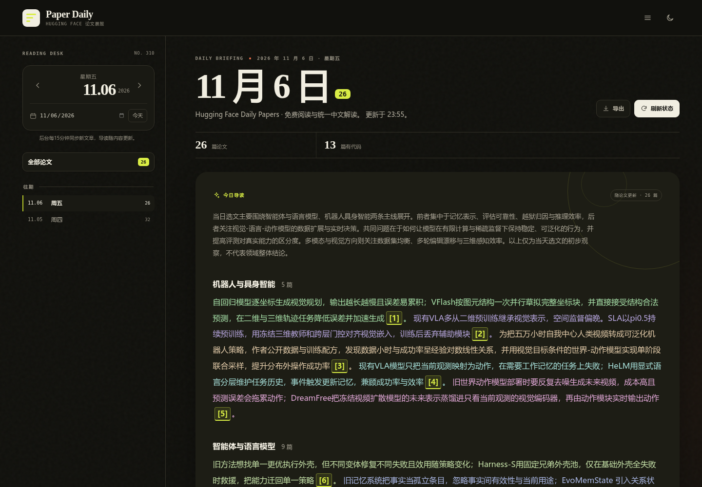
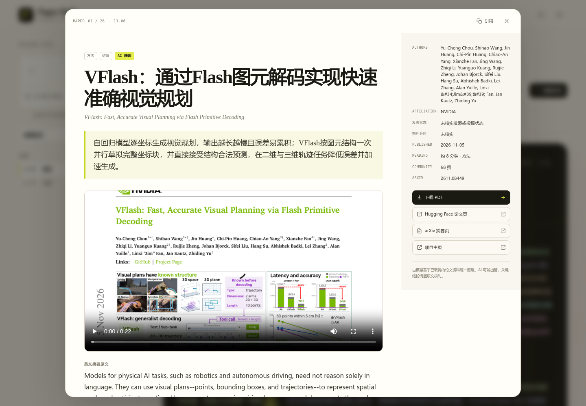
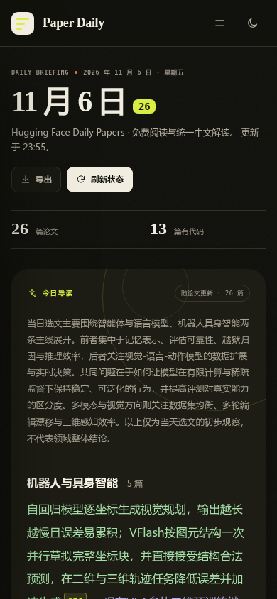

# Paper Daily · HF论文晨报

从Hugging Face Daily Papers同步每日论文，生成统一的中文单篇分析与今日导读，提供网页阅读、搜索、往期回顾、Markdown/JSON导出和PDF入口。当前版本 **1.9.1**。

访客无需登录。当前界面不提供待读、个人关键词/兴趣设置、相关度或评论。旧私人数据留在数据库，不进入公开输出，也不用于搜索或排序。

## 界面预览

以下为真实云端界面截图，截于2026年11月9日，展示11月6日的历史论文内容；文章数量和分析内容以实际页面为准。

### 今日导读与往期阅读

按研究方向汇总当天论文，以不同颜色区分逐篇要点。点击编号可打开对应论文，侧栏支持切换日期及回顾往期内容。



### 单篇论文详情

集中展示论文重点、可用的图片或视频、英文原摘要、中文分析、术语解释与方法说明，同时提供作者信息、PDF及原始来源入口。



### 手机阅读

手机上按单列阅读，日期导航可通过顶部菜单展开；同样可以查看导读并点击编号进入论文详情。



## 同步与内容

- 每15分钟检查一次当天列表，合并API和网页来源；只分析新增/未完成的论文。
- 每轮同步后按内容指纹更新简短总览，逐篇要点复用已有分析；相同内容不重复调用模型。
- 单篇分析与导读不接收个人兴趣、风格或身份；所有读者看到相同的内容。
- 页面最多每60秒读取当天状态，隐藏页面、阅读详情或提取暂停时不轮询；访客刷新不会触发模型。
- 历史正文保留，不自动重建或重复产生模型费用。

## 开发运行

Python 3.11以上，推荐3.12：

```bash
python3 -m venv .venv
.venv/bin/python -m pip install -r requirements.txt
cp config.example.yaml config.yaml
.venv/bin/python run.py --no-browser
```

在真实`config.yaml`中设置外部模型API和抓取来源；不要提交密钥。默认SQLite和下载位于`data/`，访客无需安装Python或运行代码。

## 内容与效率

模型配置为网关发现的`deepseek-v4.1-flash-1017`。详情按重点句、图片/视频、英文摘要原文、中文摘要、纵向术语、方法、主要贡献排列；新分析利用可获得的arXiv方法正文，正文缺失时明确标注只依据摘要，不猜会议/分区。

成功结果按模型、端点、凭据摘要、提示词和输入持久缓存；并发相同请求合并。失败文章最多两次自动分析尝试，间隔至少15分钟，超限保留失败提示，需管理者明确操作。模型HTTP重试仍受max_retries约束。旧文章不会因换模型或提示词自动重跑。

管理者可查实际请求和上游token用量：

```bash
python3 deploy/admin.py --token-file data/admin.token usage
```

未知用量不冒充0；上游可能忽略关闭thinking的请求选项，实际推理token以账本返回为准。缓存命中不会产生新请求。

## 当前云端访问

当前AutoDL仅提供私有验证入口。具备服务器SSH凭据的电脑执行：

```bash
ssh -N -o ServerAliveInterval=30 -p 13048 -L 8765:127.0.0.1:8765 root@region-9.autodl.pro
```

保持终端连接，浏览器访问 <http://127.0.0.1:8765>。仓库中的`./connect-cloud.sh`执行同样操作。网页无需登录，SSH认证用于连接私有服务器。刷新旧页面可使用Ctrl+F5（macOS使用Command+Shift+R）。

云端项目目录`/root/autodl-tmp/paper-daily`，screen会话`paper-daily`，仅监听本机8765。screen不能保证容器重启后自恢复。准确部署提交及备份见 [HANDOFF.md](HANDOFF.md) 与 [发布验收](docs/verification-v1.8.0-2026-11-05.md)。

## 公网部署与管理

Docker Compose+Caddy、原生systemd、HTTPS、持久化、健康检查和备份说明见 [deploy/README.md](deploy/README.md)。当前没有域名或普通云服务器，不能把开发模板视为已公开上线。

管理令牌通过`HF_PAPER_ADMIN_TOKEN_FILE`或`HF_PAPER_ADMIN_TOKEN`提供；缺少有效令牌时，配置、模型测试、手动提取、旧私人字段修改、任务详情和API文档均拒绝访问。令牌不进入前端、不放URL、不提交Git。示例：

```bash
python3 deploy/admin.py --token-file data/admin.token init-token
python3 deploy/admin.py --token-file data/admin.token status
python3 deploy/backup.py --data-dir data --config config.yaml --output /安全目录/paper-daily-backup.tar.gz
```

备份含私有数据及密钥，禁止公开上传；代码回滚和数据恢复分别处理。

## 验证与版本管理

```bash
PYTEST_DISABLE_PLUGIN_AUTOLOAD=1 .venv/bin/python -m pytest -q -p pytest_asyncio.plugin
node --check app/static/app.js
git diff --check
```

所有修改通过Git分支、提交和GitHub保存，保留发布标签供回滚。`config.yaml`、`.env`、`data/`、日志、备份和聊天记录不纳入源码仓库。
