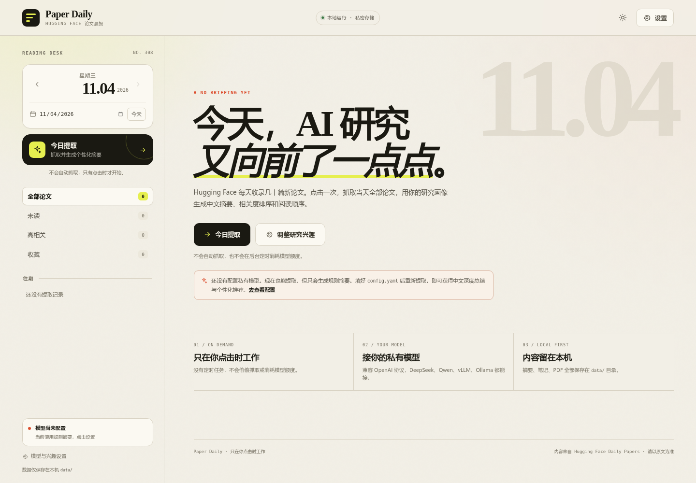

# Paper Daily · Hugging Face 论文晨报

一个**可部署到服务器、可定时更新**的 Hugging Face Daily Papers 阅读器。后台每 15 分钟检查一次新文章，用统一提示词生成面向新手的中文解读和术语小抄；个人关键词仅用于固定规则评分。今日导读在 16:00 后生成一次，成功后固定；之后仍继续更新论文。当前提供单用户云端访问，多用户登录与公网产品化留待后续开发。



> 接手开发？先读 [HANDOFF.md](HANDOFF.md)，里面有架构、数据模型、API、测试和已知风险。


## 它解决什么问题

Hugging Face 每天有几十篇新论文，全部读完不现实。Paper Daily 把这一天变成一份可以像新闻一样浏览的晨报：

- **深度科普的长解读**：先解释会卡住的概念，再讲问题、旧做法的不足、本文改了什么；配生活化类比、分步机制、具体例子、容易误解之处的澄清和术语小抄。不是逐句英译中，也不做论文审稿。
- **中文精读卡片**：中文标题、一句话结论、关键要点、方法、结果、局限，详情可读约 1500–2200 字深度科普版。
- **按关键词排序**：修改兴趣只重算个人相关度，不调用模型、不改变公共正文或导读。
- **今日导读**：先补当天最卡人的概念，再按“原来卡在哪 → 今天怎么做 → 证据 → 适用边界”组织 2–4 条主线，最后给阅读路径，让读者不需要再追问。
- **所有入口都在**：HF 论文页、arXiv、PDF 下载、GitHub 代码（作者提供时）、项目主页。
- **阅读工作流**：待读、当天搜索、往期回顾、深色模式；评论区暂未开放。
- **持久化存储**：SQLite 与 PDF 保存在运行服务的机器上；可导出 Markdown / JSON。旧私人笔记保留在数据库中，不会显示为评论。

> 解读基于论文标题、摘要、HF 的 AI 摘要和关键词生成，目前**不解析 PDF 全文**。生活化类比是为了帮助理解，不是论文结论；关键结论仍应回到原文核对。

## 快速开始

### Windows

1. 安装 [Python 3.10+](https://www.python.org/downloads/windows/)，安装时勾选 **Add Python to PATH**。
2. 双击项目根目录的 `start_windows.bat`。
3. 首次启动会自动创建 `.venv` 并安装依赖，完成后浏览器打开 `http://127.0.0.1:8765`。

命令行等价写法：

```bat
start_windows.bat
```

如果 8765 端口被占用：

```bat
.venv\Scripts\python.exe run.py --port 8766
```

### WSL / Linux / macOS

```bash
chmod +x start.sh
./start.sh
```

脚本会自动创建虚拟环境、安装依赖并打开浏览器。WSL 下若浏览器没有自动弹出，手动访问终端里显示的地址即可（通常是 `http://127.0.0.1:8765`）。

手动启动：

```bash
python3 -m venv .venv
source .venv/bin/activate          # Windows 用 .venv\Scripts\activate
pip install -r requirements.txt
python run.py
```

可选参数：`--no-browser`、`--host 127.0.0.1`、`--port 8766`。

## 第一次使用

1. 打开页面，点击左侧或页面中央的 **今日提取**。
2. 没有配置模型也能用：会抓取论文并生成**规则摘要**（保留英文原文信息）。
3. 配置私有模型后，可以点击「刷新今日」检查新文章；如果开启自动更新，后台也会按周期处理新增论文。

> 自动更新由 `config.yaml` 的 `schedule.enabled` 控制。关闭后，只有手动点击才会产生抓取和模型调用。

## 配置私有模型

模型服务配置在项目根目录的 `config.yaml`。最少只需要填三项：

```yaml
llm:
  base_url: "https://api.deepseek.com/v1"
  api_key: "sk-你的密钥"
  model: "deepseek-reasoner"
```

保存后回到页面：**设置 → 重新加载配置**，无需重启。然后点「刷新今日」。

### 常见服务示例

**DeepSeek（推荐入门，Reasoner 自带深度思考）**

```yaml
llm:
  base_url: "https://api.deepseek.com/v1"
  api_key: "sk-..."
  model: "deepseek-reasoner"
  reasoning_effort: ""       # 留空，使用模型自身思考能力
```

**通义千问 / DashScope 兼容模式**

```yaml
llm:
  base_url: "https://dashscope.aliyuncs.com/compatible-mode/v1"
  api_key: "sk-..."
  model: "qwen3-max"
  reasoning_effort: "high"
```

**Ollama 本地模型**

```yaml
llm:
  base_url: "http://127.0.0.1:11434/v1"
  model: "qwen3:32b"
  api_key: ""
  allow_no_api_key: true
  timeout_seconds: 600
  concurrency: 1
```

**vLLM / SGLang / 私有网关**

```yaml
llm:
  base_url: "http://127.0.0.1:8000/v1"
  model: "你的模型名"
  api_key: ""
  allow_no_api_key: true
  extra_headers:
    X-Gateway-Token: "your-token"
  extra_body:
    chat_template_kwargs:
      enable_thinking: true
```

以上都是 **OpenAI Chat Completions 兼容协议**。不同厂商对“深度思考”的参数名不一样，`reasoning_effort`、`extra_body` 请以你的服务商文档为准；留空时程序不会发送这些可选字段。

### API Key 不写进文件

支持环境变量：

```bash
export HF_PAPER_LLM_API_KEY="sk-..."
```

Windows PowerShell：

```powershell
$env:HF_PAPER_LLM_API_KEY="sk-..."
```

环境变量优先于 `config.yaml` 中的 `api_key`。

### 模型调用行为

- 默认并发 3，逐篇总结后生成日报导读；可在 `llm.concurrency` 调整。
- 遇到 400/422（例如服务不支持 `response_format` 或 `reasoning_effort`）会自动降级重试。
- 连续 3 次失败会熔断，避免 35 篇论文反复撞同一个错误；已完成的内容照常保存。
- 单篇失败会保留论文并降级为规则摘要，不会让整个任务消失。
- 「刷新今日」会重新抓取并调用模型，可能产生费用；页面会二次确认。

## 自动更新与 16:00 导读

在 `config.yaml`：

```yaml
schedule:
  enabled: true
  check_interval_minutes: 15
  digest_time: "16:00"
  run_on_start: true
```

行为：

- 每 15 分钟检查一次 Hugging Face 今日是否有新文章；
- 合并 API 与对应日期网页的论文列表，按 ID 去重；不会只依赖一份可能滞后的列表；
- 只分析**没有分析记录的新文章**，已有分析不重复调用模型；
- 16:00 前，今日导读显示“正在收集今天的文章”；
- 16:00 后，如果没有导读，生成一次；之后新文章仍会分析，但不再更新导读；
- 导读生成失败后按检查间隔自动重试；不会在一天内永久停止尝试；
- 服务必须保持运行；云服务器部署见 [deploy/README.md](deploy/README.md)；本地入口脚本为 `./connect-cloud.sh`。

## 自定义关注关键词

打开右上角「设置」，在「关注关键词」里添加你关心的方向，然后点击 **配置生效**。

- 最多 **12** 个关键词；
- 每个关键词 **2–30** 个字；
- 可另填一段 300 字以内的个人备注，仅保存；
- 点击「配置生效」后，页面会立即按关键词重新计算所有论文的相关度并排序；
- 兴趣、身份和风格备注均不会传入单篇分析或导读模型，后续新增内容也不会按个人偏好改写。

评分是可复现的关键词覆盖率：`100 × 匹配兴趣词数 ÷ 兴趣词总数`，四舍五入为整数。只匹配标题、摘要、HF 摘要与关键词，使用 [固定中英文术语映射](app/relevance.py)，不混入点赞、模型评分或隐藏的旧 favorite_topics。该分数是文本匹配指标，不是论文质量或概率；语义向量评分暂未引入。

公共导读按社区热度和论文 ID 选择最多 `digest.top_n` 篇（默认 18），与个人相关度无关。已有历史正文和导读保留；新增内容使用 `shared-v5` 提示词。

关键词保存在本地数据库中，优先级高于 `config.yaml` 的 `profile.interests`；这样即使不编辑 YAML，也能直接在网页调整。

## 界面与功能

| 功能 | 说明 |
| --- | --- |
| 今日提取 | 手动检查新文章；只分析没有分析记录的新论文，已有论文不重复调用模型 |
| 日期切换 | 日历、前后一天、往期记录；可补看历史日期 |
| 今日导读 | 每天 16:00 生成一次；之前显示收集进度；包含概念补课、跨论文主线、阅读路径 |
| 相关度 | 0–100，固定关键词覆盖率；不使用模型自评分或点赞 |
| 论文详情 | 概念先修、先讲人话、生活类比、分步机制、旧做法对照、例子、容易误解之处的澄清、关键要点、方法、结果、局限、原始摘要 |
| 直观展示 | 直接使用 Hugging Face 的论文缩略图；页面提供视频元数据时显示视频 |
| PDF | 首次下载后缓存到 `data/downloads/日期/`，再次点击秒开 |
| GitHub | 从摘要和 HF 论文页的作者链接中提取；**没有就不显示，不猜链接** |
| 待读 | 点击书签加入待读；左侧「待读」只显示这些论文 |
| 评论区 | 仅预留展示位置，功能暂未开放；旧私人笔记不会公开 |
| 搜索 | 搜索当前日期内的标题、摘要、标签、作者、机构 |
| 导出 | 当天全部论文导出 Markdown 或 JSON |
| 深色模式 | 跟随系统或手动切换，选择会记在浏览器 |
| 快捷键 | `/` 聚焦搜索、`Esc` 关闭、详情中 `←` / `→` 切换论文 |

## 本地文件

```text
data/
├── paper_daily.db          # 论文、摘要、待读、笔记、关键词和任务记录
├── downloads/
│   └── 2026-11-04/         # 已下载的 PDF
└── tmp/                    # cache_pdfs: false 时的临时 PDF
```

- 删除 `data/` 会同时清空待读、笔记、关键词、PDF 缓存和提取历史。
- 数据默认只保存在本机，服务默认只监听 `127.0.0.1`。
- `config.yaml` 可能含 API Key，已在 `.gitignore` 中忽略，不要提交到公开仓库。

## 主要配置项

| 字段 | 默认值 | 作用 |
| --- | --- | --- |
| `app.port` | `8765` | 本地端口，改动后需重启 |
| `app.timezone` | `Asia/Shanghai` | “今天”的判断时区 |
| `storage.data_dir` | `./data` | 数据库、PDF 的根目录 |
| `llm.base_url` | DeepSeek | OpenAI 兼容接口地址，通常以 `/v1` 结尾 |
| `llm.model` | `deepseek-reasoner` | 模型名 |
| `llm.allow_no_api_key` | `false` | 本地 Ollama/vLLM 无鉴权时设为 true |
| `llm.concurrency` | `3` | 同时总结几篇；公有 API 建议 2–4 |
| `llm.max_tokens` | `8000` | 深度科普版输出更长；provider 上限低时适当降低 |
| `llm.reasoning_effort` | 空 | `low` / `medium` / `high`，不支持则留空 |
| `llm.json_mode` | `auto` | 先尝试 JSON 模式，不支持自动降级 |
| `fetch.hf_base_url` | `https://huggingface.co` | 云端可改为 `https://hf-mirror.com` |
| `fetch.detail_pages` | `true` | 进入 HF 详情页补 GitHub/PDF/项目链接 |
| `fetch.proxy` | 空 | 例如 `http://127.0.0.1:7890`；留空读系统代理 |
| `digest.top_n` | `18` | 生成导读时最多送入多少篇，控制成本 |
| `schedule.enabled` | `false` | 是否开启后台自动检查 |
| `schedule.check_interval_minutes` | `15` | 检查新文章的间隔 |
| `schedule.digest_time` | `16:00` | 今日导读生成时间 |
| `schedule.run_on_start` | `true` | 启动后立即检查一次 |

完整注释见 [config.example.yaml](config.example.yaml)；实际生效的是 `config.yaml`。

## 网络与代理

- 抓取 Hugging Face 和下载 arXiv PDF 需要联网。
- 模型服务可以在线（DeepSeek、Qwen）或本地（Ollama、vLLM）。
- `fetch.proxy` 可单独给论文抓取设置代理；留空时读取 `HTTPS_PROXY` / `HTTP_PROXY` / `ALL_PROXY`，并尊重 `NO_PROXY`。
- 本地模型地址、`localhost`、`127.0.0.1`、`::1` 默认直连，不会被代理劫持。
- 程序显式处理了带 `[::1]` 的 `NO_PROXY`，避免部分 httpx 版本解析崩溃。

## 常见问题

**页面显示“模型尚未配置”**

填写 `api_key`，或把 `allow_no_api_key` 设为 `true`；确认 `llm.enabled` 为 `true`，然后「重新加载配置」。没有模型时功能仍可用，只是摘要为规则提取。

**测试连接失败：401 / 403**

密钥无效或没有模型权限。

**测试连接失败：404**

`base_url` 通常需要包含 `/v1`，且不要重复写 `/chat/completions`（程序会自己补）。确认模型名存在。

**请求超时**

推理模型单篇可能需要 1–3 分钟。增大 `llm.timeout_seconds`，降低 `llm.concurrency`；Ollama 首次加载模型会更慢。

**模型不支持 JSON 模式 / reasoning_effort**

保持 `json_mode: "auto"`、`reasoning_effort: ""` 即可。程序会自动尝试去掉不支持的可选参数。

**点击提取时报 Hugging Face API 返回 HTTP 400**

通常是 **Hugging Face 当天的 Daily Papers 还没发布**，不是你的 Key 或代理有问题。HF 接口会强制 `date <= 最新可用日期`，例如北京时间早上请求“今天”时，接口可能仍只接受到前一天，于是返回：

```text
date must be less than or equal to "2026-11-04T00:00:00.000Z"
```

v1.1.1 起页面会显示“HF 还没有发布某日，最新可用日期是某日”。请稍后重试，或切到提示的最新日期提取。这是上游发布节奏，不是程序抓取失败。

**Hugging Face 连不上**

检查网络；在 `fetch.proxy` 填代理。程序也会在 API 异常时尝试解析页面内嵌数据。

**某天没有论文**

HF Daily Papers 在周末/节假日可能为空，页面会提示，不会报错。

**PDF 下载失败**

arXiv 偶尔限流或需要人机验证；稍后重试。GitHub 链接只在作者提供时展示，程序不会猜测仓库地址。

**端口被占用**

```bash
python run.py --port 8766
```

**Windows 上提示找不到时区**

依赖中已包含 `tzdata`；重新运行 `start_windows.bat` 安装依赖即可。不要只复制 `.venv`，请在目标机器上重新创建环境。

**第一次启动很慢**

需要从 PyPI 下载 FastAPI 等依赖。之后的启动只检查依赖，几秒内完成。

## 开发与测试

```bash
python -m pip install -r requirements-dev.txt
pytest -q
```

当前测试覆盖：HF 数据解析、日期边界、媒体提取、GitHub 链接清理、模型 JSON 降级、鉴权错误、规则摘要、深度导读结构、SQLite 待读/笔记/任务、关键词配置与相关度重算、API 与导出。

如果本机装有 ROS 等会向 pytest 自动注册插件的环境，遇到插件导入错误可以这样运行：

```bash
PYTEST_DISABLE_PLUGIN_AUTOLOAD=1 pytest -q -p pytest_asyncio.plugin
```

### 项目结构

```text
app/
├── main.py          FastAPI 路由、静态页面、PDF/导出
├── config.py        YAML 配置、环境变量、时区
├── hf.py            HF Daily API/页面抓取、链接补全、PDF 下载
├── llm.py           OpenAI 兼容客户端、提示词输出校验、降级
├── prompts.py       论文总结（beginner-v4）与日报导读（digest-v4）提示词
├── service.py       抓取 → 总结 → 导读任务编排、熔断
├── db.py            SQLite 表结构与数据访问
├── exporting.py     Markdown / JSON 导出
├── net.py           代理与 NO_PROXY 处理
└── static/          无需构建的本地前端
run.py               启动器（含浏览器/WSL 处理）
start.sh             WSL / Linux / macOS 一键启动
start_windows.bat    Windows 一键启动
config.example.yaml  完整配置模板
```

API 文档：启动后访问 `http://127.0.0.1:8765/api/docs`。  
提示词设计与验收：[docs/prompt-v4.md](docs/prompt-v4.md)  
模型选型与架构建议：[docs/model-selection.md](docs/model-selection.md)

## 设计取舍与后续可以加的功能

已经刻意做成“按需、单机、可审计”：

- 定时检查和新文章分析由应用内后台任务完成；关闭服务才停止。
- 不把 API Key 放进浏览器；所有模型请求由本地后端发出。
- 不偷偷上传笔记、PDF 或阅读记录。
- 不猜测 GitHub 地址，避免把错误仓库归到论文名下。

如果后续想扩展，比较自然的方向：

1. 解析 PDF 全文，让方法/实验部分的总结更可靠。
2. 跨日期语义搜索与“本周/本月回顾”。
3. 按主题订阅，生成每周研究简报。
4. 导出到 Obsidian / Notion / Readwise。
5. 一键缓存当天全部 PDF 并打包。
6. 接入本地 embedding，做相似论文和“顺着读”推荐。

---

内容来自 [Hugging Face Daily Papers](https://huggingface.co/papers)，版权归原作者。本工具仅用于个人研究阅读；AI 摘要可能出错，请以论文原文为准。
